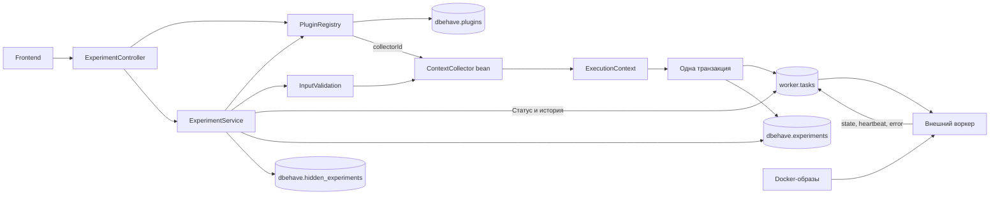

# Архитектура платформы

Плагин хранится в PostgreSQL как описание `PluginDefinition`. Оно содержит имена Docker-образов, базовые контексты контейнеров, шаблон ссылки Grafana, сценарии с BDUI-полями и `collectorId`. Сами Docker-образы находятся в реестре образов или локальном Docker Engine.



| Таблица | Содержимое |
|---|---|
| `dbehave.plugins` | `id` и `definition jsonb`, общий каталог плагинов и сценариев |
| `worker.tasks` | Очередь, готовый `context jsonb`, состояние, даты, heartbeat, worker_id и error |
| `dbehave.experiments` | `task_id`, id/названия плагина и сценария, ссылка и шаблон Grafana, снимок пользовательских параметров `configuration` |
| `dbehave.hidden_experiments` | Идентификаторы запусков, удалённых из истории |

`PluginDefinition` — Java record описания плагина. `Scenario` задаёт сценарий и два списка полей `settings` и `params`. `FieldSpec` описывает ключ, подпись, тип, default, границы, единицу измерения и варианты выбора. По этим данным бэкенд строит BDUI-форму и проверяет ввод.

`ContextCollector` — Java-интерфейс исполняемого преобразователя. Spring регистрирует реализации `postgres`, `mongo`, `clickhouse` и `generic` в `PluginConfiguration`. `PluginRegistry` находит бин по `collectorId` из БД. При регистрации плагина проверяются доступность коллектора и сборка его сценариев с defaults.

`PluginCatalogInitializer` добавляет определения PostgreSQL, MongoDB и ClickHouse, если соответствующих записей ещё нет. Существующие определения сохраняются. При запросах каталог читается из БД через `PluginRepository` и преобразуется из JSON в `PluginDefinition`.

Пример `definition` с одним сценарием и двумя BDUI-полями

```json
{
  "id": "postgres",
  "title": "PostgreSQL 18",
  "collectorId": "postgres",
  "loaderImageName": "dbehave/postgres-load:0.1.0",
  "databaseImageName": "postgres:18",
  "grafanaUrlTemplate": "http://localhost:3001/d/dbehave-postgres?var-run_id={runId}",
  "loaderImageContext": {
    "core_max": 0.5
  },
  "databaseImageContext": {
    "mem_max": 1073741824
  },
  "scenarios": [
    {
      "id": "write-heavy",
      "title": "Запись",
      "description": "Параллельные INSERT",
      "settings": [
        {
          "key": "shared_buffers",
          "title": "Кеш страниц",
          "description": "Память PostgreSQL",
          "type": "INTEGER",
          "defaultValue": 128,
          "min": 16,
          "max": 8192,
          "unit": "МБ",
          "options": []
        }
      ],
      "params": [
        {
          "key": "clients",
          "title": "Клиенты",
          "description": "Параллельные соединения",
          "type": "INTEGER",
          "defaultValue": 16,
          "min": 1,
          "max": 256,
          "unit": null,
          "options": []
        }
      ]
    }
  ]
}
```

## Прохождение запуска

1. Фронтенд получает плагины через `GET /api/plugins`, сценарии через `GET /api/scenarios?pluginId=...` и форму через `GET /api/ui/experiment?pluginId=...&scenarioId=...`.
2. `POST /api/experiments` передаёт `pluginId`, `scenarioId`, `settings`, `params` и ограничения обоих контейнеров. `ExperimentService` читает описание из каталога. `InputValidation` подставляет defaults, проверяет типы, границы, варианты и неизвестные ключи. `JsonbValidation` проверяет допустимость JSON для PostgreSQL и обратного чтения перед коллектором и сохранением. `core_max` задаётся положительным числом ядер, `mem_max` — положительным целым числом байт.
3. Выбранный коллектор собирает контексты образов. PostgreSQL-коллектор преобразует настройки в аргументы `postgres -c`, параметры сценария в env. Затем сервис применяет ограничения контейнеров и создаёт снимок `ExecutionContext` с четырьмя ключами.
4. `ExperimentService.start()` в одной транзакции записывает задачу `QUEUED` в `worker.tasks` и сведения для отображения в `dbehave.experiments`. Названия, шаблон Grafana и нормализованные параметры сохраняются на момент запуска. Ответ `201` содержит ID, состояние, даты, ссылку Grafana с подставленным `{runId}` и `configuration` со значениями по умолчанию и применёнными лимитами.
5. Внешний воркер забирает задачу, запускает образы с её контекстом, применяет ограничения и обновляет состояние, heartbeat и ошибку. Он также передаёт метрики с `run_id` для Grafana.
6. Фронтенд опрашивает `GET /api/experiments/{id}` каждые две секунды до завершения. История `GET /api/experiments` возвращает последние 100 задач и обновляется с тем же интервалом, пока в списке есть активные задачи. Запросы соединяют текущее состояние из `worker.tasks` с сохранёнными сведениями из `dbehave.experiments`.

При `params.clients = 2` сервис сохраняет такой снимок выполнения

```json
{
  "loaderImageName": "dbehave/postgres-load:0.1.0",
  "databaseImageName": "postgres:18",
  "loaderImageContext": {
    "core_max": 0.5,
    "command": [],
    "environment": {
      "SCENARIO": "write-heavy",
      "CLIENTS": "2",
      "DB_HOST": "database",
      "DB_PORT": "5432",
      "DB_NAME": "dbehave",
      "DB_USER": "dbehave",
      "DB_PASSWORD": "dbehave",
      "PGPASSWORD": "dbehave"
    }
  },
  "databaseImageContext": {
    "mem_max": 1073741824,
    "command": [
      "docker-entrypoint.sh",
      "postgres",
      "-c",
      "shared_buffers=128MB"
    ],
    "environment": {
      "POSTGRES_DB": "dbehave",
      "POSTGRES_USER": "dbehave",
      "POSTGRES_PASSWORD": "dbehave",
      "DBEHAVE_SHARED_BUFFERS": "128MB"
    }
  }
}
```

API истории и статуса возвращает `ExperimentRun` с метаданными, состоянием и снимком `configuration`. На странице запуска параметры находятся в раскрывающемся блоке. У старых запусков `configuration = null`, поскольку исходный ввод до этой миграции отдельно не сохранялся. Контекст выполнения остаётся в таблице воркера.

`DELETE /api/experiments/{id}` добавляет идентификатор в `dbehave.hidden_experiments`, после чего запуск исчезает из истории и его API возвращает `404`. `DELETE /api/experiments` с телом `{"runIds":["1","2"]}` атомарно скрывает выбранные записи. Запрос без тела скрывает все существующие записи, включая задачи без метаданных. Эти операции сохраняют состояние и даты задачи, поэтому воркер может завершить выполнение. Метрики продолжают храниться в Prometheus. В интерфейсе удаляются отмеченные галочками записи после подтверждения в модальном окне, «Выбрать все» действует на текущий отображаемый список.

`POST /api/experiments/compare` принимает `runIds` и проверяет совпадение сохранённого шаблона Grafana и `scenarioId`. Ответ содержит `grafanaUrl` с повторяющимися переменными, например `?var-run_id=1&var-run_id=2`. Другие параметры ссылки сохраняются. Для старых записей шаблон восстанавливается из сохранённой ссылки заменой ID на `{runId}` при миграции.

`GrafanaUrl` добавляет `kiosk=1` к ссылкам одиночных запусков и сравнения. Так Grafana показывает селекторы переменных борда. Та же обработка применяется к ссылкам старой истории при чтении API. Явное значение `1` сохраняется при обработке URL фронтендом и перезагрузке Grafana.

Ошибки ввода возвращаются как `400` с `fieldErrors`, отсутствующий плагин, сценарий или запуск — `404`, повторная регистрация id — `409`. Ошибка выполнения приходит из `worker.tasks.error` вместе с состоянием `FAILED`. При отсутствии подключённого воркера созданная задача остаётся `QUEUED`.

| Каталог | Назначение |
|---|---|
| `backend/src/main/java/io/dbehave/backend/web` | HTTP-методы в `ExperimentController` |
| `backend/src/main/java/io/dbehave/backend/plugin` | Чтение и изменение каталога, выбор коллектора, начальная регистрация |
| `backend/src/main/java/io/dbehave/backend/experiment` | Форма, запрос запуска, подготовка, транзакция запуска и `ExperimentRun` |
| `backend/src/main/java/io/dbehave/backend/task` | `ExecutionContext`, запись задач и SQL-запросы статуса/истории |
| `backend/src/main/java/io/dbehave/backend/validation` | Проверка пользовательских полей и ресурсов |
| `backend/src/main/java/io/dbehave/backend/config` | Spring-бины коллекторов и настройки JSON |
| `plugin-api/src/main/java/io/dbehave/plugin` | `PluginDefinition`, `Scenario`, `FieldSpec`, `ContextCollector` |
| `plugins/postgres` и `plugins/postgres-load` | PostgreSQL-коллектор и отдельное приложение нагрузчика |
| `plugins/clickhouse` и `plugins/clickhouse-load` | ClickHouse-коллектор, четыре сценария и отдельный нагрузчик |

Пакеты бэкенда находятся в `backend/src/main/java/io/dbehave/backend`, миграции — в `backend/src/main/resources/db/migration`.
